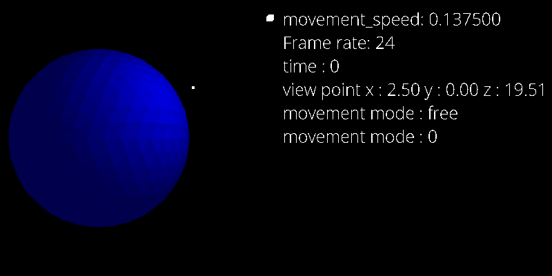

# 3D Graphics Engine

A real-time 3D graphics engine written in C++ from scratch, with no graphics engine or rendering library. Built on SDL2 for windowing and input only; every part of the rendering pipeline is hand-implemented.

## What it does

The engine renders navigable 3D scenes from arbitrary OBJ model files. You can walk through the scene with keyboard controls, and the world updates in real time.

**Rendering pipeline:**
- Perspective projection: 3D points are projected onto a view plane defined by a movable camera ray and an up vector
- Polygon rasterization: projected polygons are filled using a scanline row-fill algorithm
- Hidden surface removal: back-face culling using polygon surface normals; front-facing polygons are rendered, back-facing polygons are discarded
- Phong-style illumination: per-polygon shading computed from surface normals, one or more light sources, and ambient light
- View frustum clipping: polygons that cross the view boundary are clipped before rasterization

**Scene and objects:**
- Loads standard `.obj` files (vertices, faces); included models: cube, sphere, low-poly sphere, fox, shoe, Utah teapot
- Procedural object constructors for cubes and planes at arbitrary positions and orientations
- Object rotation and translation
- Distance buffer for correct depth ordering between overlapping polygons

**Camera:**
- Free-look camera controlled by spherical angles (theta/phi)
- Configurable movement speed and turn speed
- Frame rate targeting with frame time measurement

## Tech

- **Language:** C++
- **Windowing/input:** SDL2, SDL2\_image, SDL2\_ttf
- **Build:** g++ (MinGW on Windows; SDL2 on *nix)
- **No:** OpenGL, Vulkan, DirectX, or any rendering API

## Building

**Windows (MinGW):**

```
g++ src/main.cpp src/input_handler.cpp src/3d.cpp src/2d.cpp src/Object.cpp \
  -o build/game.exe \
  -Iinclude -Llib \
  -lmingw32 -lSDL2main -lSDL2 -lSDL2_image -lSDL2_ttf \
  -mwindows -mconsole
```

Or open in VS Code and run the default build task (`tasks.json` is included).

**Linux/macOS:**

Install SDL2 via your package manager (`brew install sdl2 sdl2_image sdl2_ttf` on macOS), then:

```
g++ src/main.cpp src/input_handler.cpp src/3d.cpp src/2d.cpp src/Object.cpp \
  -o build/game \
  -Iinclude \
  -lSDL2 -lSDL2_image -lSDL2_ttf
```

## Project structure

```
src/
  main.cpp              entry point, render loop, scene setup
  3d.cpp / include/3d.h  Point3D, Ray, Frame, LightSource, projection math
  2d.cpp / include/2d.h  2D rasterization, clipping, scanline fill
  Object.cpp             OBJ loader, illumination, 3D-to-2D projection
  input_handler.cpp      keyboard/event handling
  Objects/               sample OBJ files (cube, fox, sphere, teapot, shoe)
  Screenshots/           captured frames
```

## Screenshot


